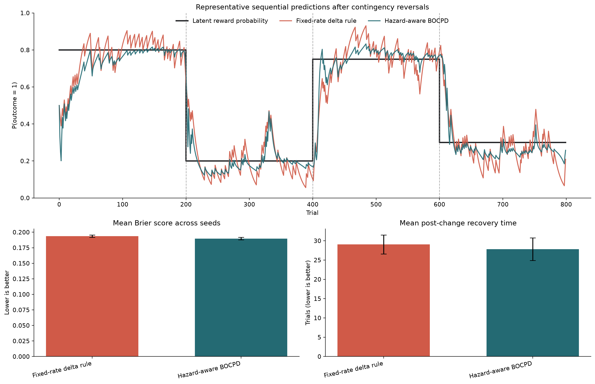
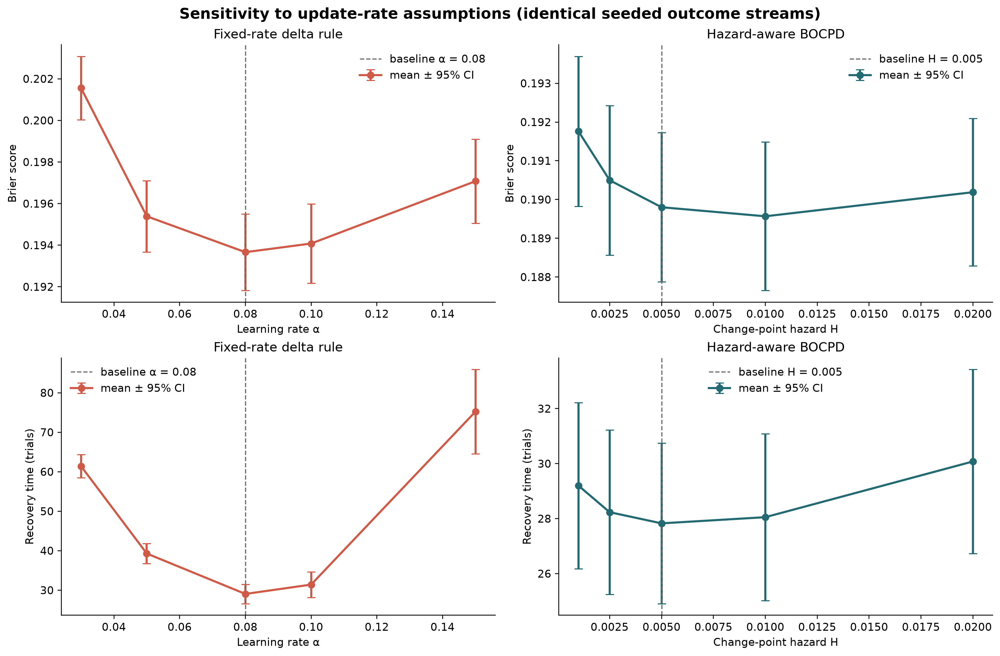

# Prediction Error Lab

**A reproducible benchmark for evaluating belief updating under volatility.**

This project compares a fixed-rate prediction-error learner with a hazard-aware Bayesian online change-point detector (BOCPD) in a controlled Bernoulli reversal environment. It is deliberately small, inspectable, and designed as a research-engineering benchmark rather than a claim about biological learning or a new change-point algorithm.



## Research question

> Under abrupt changes in an outcome contingency, can a hazard-aware Bayesian learner improve sequential predictive accuracy and recover at least as quickly as a fixed-rate delta-rule baseline?

The pre-specified comparison uses identical outcome streams for both models over 64 random seeds. The environment contains four 200-trial Bernoulli segments: `0.80 → 0.20 → 0.75 → 0.30`.

## Result at a glance

The committed result is generated by `configs/reversal_benchmark.json`. Intervals are descriptive normal-approximation 95% intervals; they are **not** hypothesis tests.

| Metric | Fixed-rate delta rule | Hazard-aware BOCPD | Direction |
| --- | ---: | ---: | --- |
| Brier score | 0.1937 ± 0.0018 | **0.1898 ± 0.0019** | lower is better |
| Negative log-likelihood | 0.5808 ± 0.0039 | **0.5678 ± 0.0042** | lower is better |
| Latent tracking MAE | 0.0881 ± 0.0018 | **0.0628 ± 0.0025** | lower is better |
| Recovery time | 29.04 ± 2.45 trials | **27.83 ± 2.92 trials** | lower is better |

Within this particular synthetic setting, BOCPD improves predictive and latent-tracking scores and has a small mean recovery-time advantage. The result does **not** establish that it will dominate fixed-rate learning in real-world or neural data; see [limitations](docs/limitations.md).

## Update-rate sensitivity analysis (v0.2)

The baseline result is now accompanied by an explicit, versioned robustness grid: five delta-rule learning rates and five BOCPD hazards, all evaluated on the same 64 seeded outcome streams.



The result is useful precisely because it is not a simplistic victory plot:

- Within the selected grid, the delta rule's default \(\alpha=0.08\) is best on both mean Brier score and mean recovery time.
- BOCPD's default \(H=0.005\) has the shortest mean recovery time, while \(H=0.01\) has a slightly lower mean Brier score.
- Therefore, the apparent advantage depends on whether the evaluation values stable probabilistic accuracy, latent tracking, or rapid recovery after a reversal.

This is an explicit sensitivity analysis, not a claim of global optimisation or pre-registration. Its configuration, tables, and figure are fully reproducible through `configs/sensitivity_benchmark.json`.

## Why this is a research-engineering project

- The question, models, assumptions, and failure modes are explicit.
- Models are evaluated over multiple seeded runs rather than one attractive trace.
- The package, config, tests, and result-generation command are separate from exploratory notebooks.
- Committed tables and the figure can be regenerated from one JSON config.
- The benchmark records what its metrics cannot mean outside simulation.

## Relationship to existing work

This repository does **not** propose a new BOCPD algorithm. Its compact
Beta-Bernoulli reference implementation is inspired by the causal run-length
inference formulation of Adams & MacKay (2007), *Bayesian Online Changepoint
Detection* ([paper](https://arxiv.org/abs/0710.3742)).

Mature BOCPD implementations already exist, including
[`bayesian_changepoint_detection`](https://github.com/hildensia/bayesian_changepoint_detection)
and [`bocd`](https://github.com/gwgundersen/bocd). The contribution here is a
transparent **evaluation surface**: identical observation streams, explicit
assumptions, multiple seeds, calibration-oriented metrics, recovery dynamics,
and a documented sensitivity analysis.

The surrounding scientific question also belongs to an established research
line on volatility-sensitive learning: for example, Behrens et al. (2007)
modelled adaptive learning in uncertain environments
([doi](https://doi.org/10.1038/nn1954)), and the Hierarchical Gaussian Filter
models uncertainty and volatility in cognitive modelling. This benchmark is not
an HGF or an active-inference implementation. For a discrete-state
active-inference toolkit, see [`pymdp`](https://github.com/infer-actively/pymdp).

See [references](docs/references.md) for full attribution and scope.

## Reproduce

```bash
git clone <your-repository-url>
cd prediction-error-lab

python -m venv .venv
source .venv/bin/activate
python -m pip install --upgrade pip
python -m pip install -e ".[dev]"

ruff check src tests
pytest
prediction-error-lab --config configs/reversal_benchmark.json --output-dir results
prediction-error-sensitivity --config configs/sensitivity_benchmark.json \
  --output-dir results/sensitivity
```

To keep the repository compact, trial-level results are not committed by default. Add `--save-trials` when you need them locally.

## Repository map

```text
prediction-error-lab/
├── configs/       # pre-specified experiment parameters
├── docs/          # methodology, decisions, limitations, and references
├── results/       # committed derived tables and figure
├── src/           # package source of truth
├── tests/         # tests for environment, learners, metrics, and reproducibility
├── scripts/       # thin command wrapper
└── .github/       # CI: lint + tests on Python 3.10–3.12
```

## Models and metrics

The baseline is a fixed-rate delta rule:

\[
v_{t+1}=v_t+\alpha(o_t-v_t)
\]

The second model maintains a posterior over possible run lengths and uses a Beta-Bernoulli predictive model. A constant hazard expresses the prior chance that an observation began a new latent segment. It is a minimal reference implementation inspired by Adams & MacKay (2007), not a replacement for a production BOCPD library. Full details are in [methodology](docs/methodology.md).

We report Brier score, negative log-likelihood, latent tracking MAE, and the number of trials required to remain within a fixed tolerance of the newly simulated contingency after each reversal.

## What this does not claim

- BOCPD here is not an implementation of active inference or a neural model.
- A synthetic Bernoulli reversal task is not a proxy for a human experiment.
- The known simulation cadence informs the hazard assumption; that is useful for a controlled benchmark but requires sensitivity analysis before deployment.
- One baseline is not an exhaustive model comparison.

## Implemented and next experiments

1. Sensitivity analysis: an explicit learning-rate and hazard grid is implemented in version 0.2.
2. Compare against adaptive-rate delta rules and a hidden Markov model.
3. Evaluate out-of-distribution segment lengths and gradual rather than abrupt contingency shifts.
4. Connect the benchmark to a formal active-inference agent only after defining the generative model and its falsifiable predictions.

## License

MIT. See [LICENSE](LICENSE).
